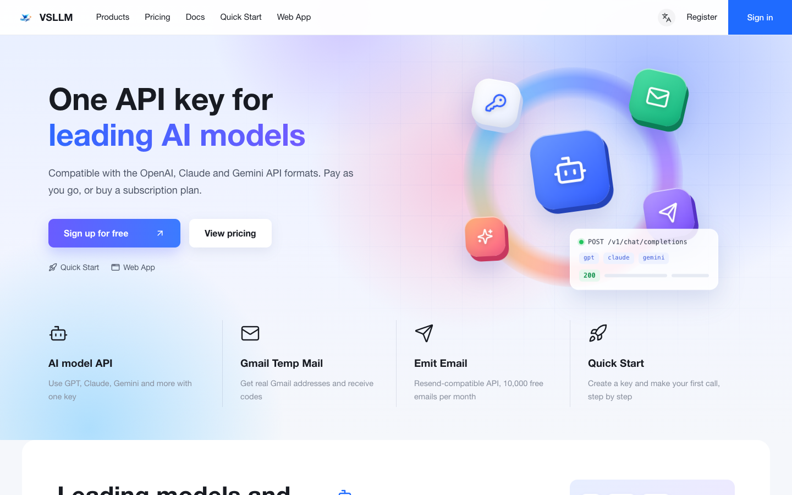
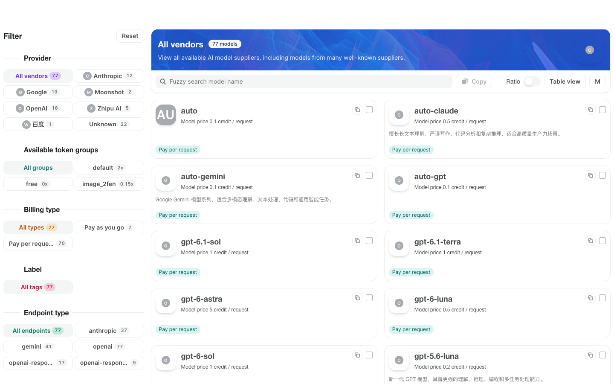
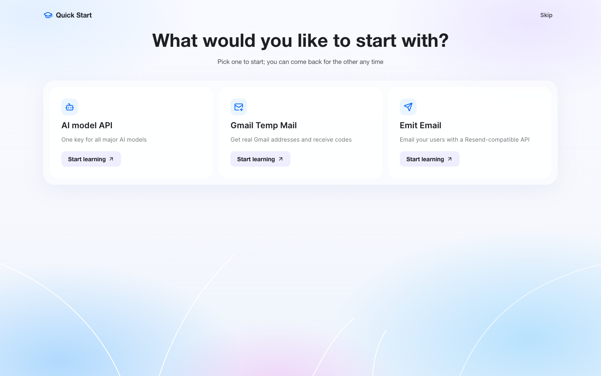

# VSLLM 测评：77 个模型按次计费，Claude、GPT、Gemini 一把 Key 怎么用

VSLLM 的优势很直观：公开价格页当前展示 77 个模型，既有按次请求，也有按量计费；OpenAI、Claude、Gemini 等模型可以用一把 Key 管理。对于任务长度相对稳定、希望直接知道“调用一次多少钱”的用户，它比复杂倍率表更容易上手。

[查看 VSLLM 当前模型价格](https://vsllm.cc/i/njv6)

## 按次计费适合哪些任务

短代码修改、固定格式摘要、分类、翻译和日常问答，单次请求长度比较稳定，按次价格容易控制。超长文本、巨量输出和频繁工具循环则应同时考虑请求限制与 Token 消耗。VSLLM 价格页将模型、单次价格、供应商和端点类型一起展示，选模型时路径很短。

## 选模型不要只看最低价

页面中既有轻量模型，也有更高阶的 GPT、Claude 与 Gemini 路线。第一次调用可以从低价模型开始确认接口；真正工作时，应根据代码、长文、多模态或复杂推理需求升级。完成一次任务的价值，比最低单次价格更重要。

## 注册、充值与第一次调用

1. 通过入口注册 VSLLM；
2. 登录后进入充值/钱包页，选择当前金额和支付方式；
3. 首次充值覆盖一周轻量任务即可；
4. 创建独立 API Key；
5. 从价格页复制模型 ID；
6. 按 Quick Start 填写地址、Key 和模型；
7. 在日志中核对请求次数与扣费。

## Claude Code、Codex 怎么选

Claude Code 使用 Claude/Anthropic 对应端点，重点看流式输出与工具调用；Codex 使用 OpenAI 或 Responses 路线，重点看函数调用和长输出。两个客户端分别创建 Key，可以直接比较一周成本，也便于单独限额。

## 它能替代什么

如果你现在分别购买多家模型接口，VSLLM 可以作为统一入口；如果你只是偶尔使用高阶模型，按次方式也能避免长期订阅。它还适合先在网页端体验，再把固定任务迁到 API。

## 购买建议

从一把限额 Key、一个轻量模型开始。连续完成 20—50 次真实任务后，再选择更强模型。固定短任务用按次路线，长输出任务同时比较按量价格，避免为了单次便宜而承担不可控长度。

## FAQ

### VSLLM 有多少模型？
公开价格页当前显示 77 个，覆盖多个供应商与接口类型。

### 按次一定比按 Token 便宜吗？
任务长度稳定时更直观；超长输入输出需要结合限制和按量方案比较。

### 充值后怎么接客户端？
创建 Key，从价格页复制模型 ID，再按快速指南填写 API 地址。

[注册 VSLLM，完成第一笔低成本调用](https://vsllm.cc/i/njv6)
